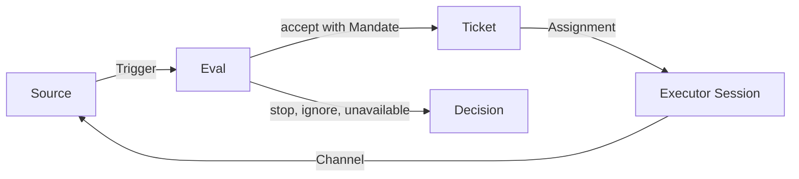

# dsh-superagent

> **Research prototype for reference only, not an official DeepSeek product.** This code grew out of our team's day-to-day development work, with much of the engineering done by coding agents. Treat it as research code, not production-ready software. It may still contain bugs, and its coding style and engineering practices may be inconsistent. Review and adapt it before using it in your own environment.
>
> We have adapted it for publication, so it is not identical to our internal version or the implementation described in *Exploring Super-agent Design: Towards a More Autonomous Agent System*. Some designs discussed in the article are directions for future development and are not implemented in this prototype.

dsh-superagent is a proactive coding agent for one GitHub repository, packaged as a bundle for [DeepSeek Harness](https://www.deepseek.com/en/harness/). It listens to GitHub and, optionally, Feishu. When someone allowed asks the agent for work, it opens a work item, works on it in its own agent session and directory, and answers in the original conversation, for example with a pull request. A web panel shows what needs a person.

It is also a way of working with an agent: **take as little human attention as possible, and give as much value as possible.** An agent that can act for a whole team can also waste a whole team's attention, so it acts only when asked or when a rule the team wrote allows it, and speaks only when someone must act or can use a result. [docs/000-philosophy.md](docs/000-philosophy.md) explains the principle and what it asks of the operator.

## What it does

- **Watches where the team already works.** GitHub issues, pull requests, reviews, comments and CI become Triggers; a Feishu Source can add chats.
- **Acts under a versioned Policy.** A Source's Policy holds the allowed people, the admission rules and the bots that may propose work. A request the Policy does not admit cannot start a Ticket.
- **Runs each accepted request as a Ticket.** A Ticket carries its Mandate — the scope and Policy version it was accepted under — and gets its own Executor Session and checkout directory.
- **Answers where the request was made.** It replies in the original conversation and, for code work, opens a pull request as its own GitHub account.
- **Keeps attention on what needs a person.** The Superagent panel shows waiting questions, work awaiting review and setup problems first; activity counts and history stay secondary.

## How it works



A **Source** (GitHub, or optionally Feishu) turns an event into a **Trigger**. **Eval** judges the Triggers it batches against the current Policy and either accepts one with a **Mandate**, stops it, ignores it or records that it could not judge it. An accept creates a **Ticket**, which runs in its own **Executor Session** and directory.

The Executor reports back and writes through the Source's **Channel** — a GitHub comment or pull request, or a Feishu reply. Later messages on the Threads a Ticket follows reach it as context; a person's message there goes to its Executor without a new Decision. [001 Domain model](docs/001-domain.md) defines these terms; [002 Authorization](docs/002-authorization.md) explains who may start work.

## Setup

Setup has many steps, so an agent does it with you. Ask your coding agent:

> Read SETUP.md in this repository and set up dsh-superagent with me.

It asks one short question at a time, shows the full plan once, and then installs and configures everything. [SETUP.md](SETUP.md) is what it follows. Prerequisites, the accounts it needs, manual installation and operation are in [006 Deployment](docs/006-deployment.md).

## Documentation

Read the numbered documents in order; each builds only on the ones before it.

- [000 Philosophy](docs/000-philosophy.md): the attention principle the design follows
- [001 Domain model](docs/001-domain.md): Sources, Triggers, Tickets and the other terms
- [002 Authorization](docs/002-authorization.md): who may start work, and how a request is admitted
- [003 Execution](docs/003-execution.md): how a Ticket is prepared, executed and delivered
- [004 Prompts](docs/004-prompts.md): the text a team writes, and the built-in parts
- [005 Panel](docs/005-panel.md): supervising the agent from the web panel
- [006 Deployment](docs/006-deployment.md): manual setup, configuration, upgrades and troubleshooting
- [007 Architecture](docs/007-architecture.md): the implementation guide and code index
- [008 Cookbook](docs/008-cookbook.md): adding a Source

## Repository layout

| Path | Contents |
| --- | --- |
| `docs/` | The numbered design and operations documents |
| `src/` | Implementation: domain engine, Sources, Executor, panel and runtime |
| `prompts/` | Prompt sections assembled for the main Session and Executors |
| `skills/` | Agent skills shipped with the bundle |
| `tests/` | Vitest suites |
| `scripts/` | Start, stop and status scripts |
| `examples/` | A sample DeepSeek Harness profile configuration |
| `locale/` | Panel translations, English and Simplified Chinese |
| `cordis.patch.yml` | The DeepSeek Harness bundle patch |

[007 Architecture](docs/007-architecture.md) maps every module and test.

## Development

Node.js 22.19+ or 24+ and pnpm 11 are required.

```sh
pnpm install
pnpm check
```

`pnpm check` runs the typecheck, the tests and the build. The three steps can also be run on their own with `pnpm typecheck`, `pnpm test` and `pnpm build`.

## License

[MIT](LICENSE)
