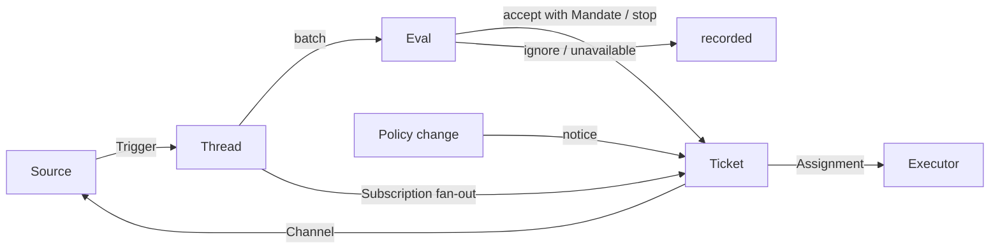

# 001 领域模型

> 本文件译自英文原文 [001-domain.md](../001-domain.md)。如有出入，以英文原文为准。

本文命名 dsh-superagent 的概念，以及每个概念所遵守的规则。代码、智能体调用的工具、面板和其他文档都只使用这些术语，不用别的。按照 [000 理念](000-philosophy.md)，模型只包含工作所需的概念，而业务需求会成为其中某个概念的属性。

## 流程

工作从触发流向评估，再流向执行。来源产生触发。一个触发会作为上下文扇出到订阅了其线程的工单。以这种方式到达某张工单的人的消息，就留在该工单；其他每个触发都进入评估，由评估决定它是否请求新工作。评估接受时，会创建一张带授权的工单。派工把工单交给执行器，结果再通过渠道回到来源。

## 概念

来源、线程、评估、授权和订阅构成核心领域，其余概念为它们提供支撑。

| 概念 | 定义 | 遵守的规则 | 存在的原因 |
| --- | --- | --- | --- |
| 来源 | 一条事件流。来源类型是可复用的实现；来源实例是某个类型的一份配置：是否运行、监听什么 | 保存自己的读取位置和自己的机器人身份。定义什么算作事件，包括只在时间推移后才成立的条件。在进入领域之前，丢弃机器人自己的消息以及监听范围之外的触发。把每个触发转换为其所属的线程，以及用于回复的渠道地址 | 重启时不能重放事件 |
| 触发 | 一个不可变事件，带有来源自身的元数据，例如其行为者 | 属于一个或多个线程。同一触发被接受两次只创建一张工单 | 审计与幂等的单位 |
| 线程 | 按时间排序的触发；由来源定义哪些触发构成一个线程 | 同一时刻最多有一个评估在其上运行。它可以有多张工单。它持有自己的订阅、正在运行的评估以及决定历史 | 为评估提供一致的视图和上下文 |
| 关联 | 一个触发所属的多个线程之间的关系 | 只补充上下文，从不做路由 | 让评估能追踪相关证据 |
| 渠道 | 线程的写入侧；其地址由来源定义 | 一个线程可以有多个渠道；一张工单持有一组渠道 | 确认、回复、PR 和已解决的审查意见都算写入 |
| 策略 | 带版本的研判规则，以及每个来源的那一部分：谁能以该来源自己的身份通过该来源发起工作、名单如何同步、哪些机器人可以产生候选 | 策略版本涵盖规则、接受模式和来源部分。与在途工单相关的变更（例如它当初依据的某条规则发生改变）会投递给它的派工；但这不会撤销授权。不同来源上的身份之间从不互相映射 | 规则一变，正在运行的评估就必须丢弃 |
| 评估 | 对一批触发的研判，分两层：准入与研判 | 输入：触发批次、线程快照、该线程上的所有工单（包括已结束的）以及当前策略。输出：一个决定。不持有状态 | 决定新工作是开始、继续还是停止 |
| 授权 | 一次接受所授予的内容：策略版本、范围、强度、匹配到的规则、发送者在该来源上的身份，以及来源接收该触发的方式 | 不可变；范围扩大就意味着新建工单。工单结束不会结束授权：只有人的停止才会撤回它，而不再支持它的策略会撤销它。已结束的工单恢复之前，会按当前策略重新校验 | 说明这项工作凭什么可以做、能走多远 |
| 工单 | 一个经授权的工作单位 | 只有评估能创建工单。它引用自己的授权，持有自己的渠道和输入。状态从开启 → 结束，当某人在其某个线程上发消息使其恢复时再回到开启，除非有人停止了它。工单定义自己的状态，而不跟随执行器的状态 | 拥有执行过程及其报告 |
| 派工 | 工单与一个执行器实例之间的绑定 | 一张工单随时间会有多个派工。其状态按待启动 → 执行中 → 已结束变化，与工单状态相互独立。只有它的最终报告可以代表执行器一侧结束工单 | 执行器在领域之外，但“谁在执行”必须在领域之内 |
| 订阅 | 工单与线程之间的多对多关系，由线程持有 | 匹配的触发会扇出到每张订阅中的在途工单，不检查发送者是谁；以这种方式到达工单的人的消息不经过评估。执行器为获取上下文而关注的线程也以同样方式到达其工单，但不赋予它任何权限，也不会使它恢复。已结束的工单保留其订阅，包括已关闭或已合并的 PR 的订阅：人的消息会在同一授权下使它恢复，无需评估或决定；来自机器人和 CI 的消息不会到达它，因为其执行器在恢复时会重新读取它的线程。被人停止的工单不再接收任何内容。主 Session 只有在消息明确指向某张工单时，才会把线程附加到该已有工单。人可以丢弃线程上的所有订阅；执行器只能丢弃自己工单对某个它认为无关的线程的订阅，但不包括其工单起始于的那个线程，以及来源让它关注的线程，例如其 PR 的线程 | 后续讨论无需任何人再次提及智能体就能到达执行器 |

人不是领域概念。触发携带其行为者的标识符，形式由来源给出。允许列表是策略中某个来源的部分，使用该来源的身份。同一个人在多个来源上拥有账号，这是智能体在需要时读取的提示词文本。

执行器连同其会话和目录，位于领域之外，通过派工与领域相连。

聚合：来源持有其读取位置。线程持有其订阅、正在运行的评估（串行运行，并把期间到达的触发并入下一批）以及决定历史。工单持有其派工、渠道和输入，并按 id 引用决定。

## 被否弃的概念

| 被否弃的概念 | 理由 |
| --- | --- |
| 把主体（Principal）或成员关系（Membership）作为实体，或跨来源映射身份 | 人只是触发的元数据；允许列表是策略中某个来源的部分；跨来源映射是提示词文本 |
| 让评估调度自己的延迟触发 | 需要等待的条件属于普通来源，因此评估从不反向依赖来源 |
| 评估的“等待中”或“已撤销”状态 | 等待属于来源；超时的评估会重新排队其触发，或者以 `unavailable` 结束 |
| 每个线程最多一张在途工单 | 一个线程可以承载多项相互独立的工作；研判会依据工单列表避免重复 |
| “追加到工单”这类决定 | 追加就是订阅扇出，不需要评估 |
| 在订阅上做准入检查 | 订阅覆盖整个线程；授权把权限与上下文分开 |
| 会做路由的关联 | 订阅负责路由；关联只补充上下文 |
| 跟随 DSH 会话的工单状态 | 工单可以被移交、恢复，或由多个执行器运行，因此它定义自己的状态 |
| 执行器宣称有人要求它停止 | 只有评估能判定一次结束的强度 |
| 策略变更时取消运行中的工单 | 被取消的变更会留下半成品；正确做法是记录并投递该变更 |
| 执行器 Session 失败或受阻时锁定其全部工具 | 这会拒绝直接在会话中工作的人，也会拒绝恢复后的报告；暂停自动输入就足够了 |
| 从报告的自由文本推断“在等人” | 分类需要结构化事实；执行器通过结构化字段来询问 |

## 哪些部分可复用

上述概念及其规则是可复用的。来源实现、策略内容、执行器和渠道实现属于具体部署。每个来源在内部保留自己的用词，例如消息、群聊或通知，并把它们转换成触发。

| 部分 | 本仓库中的情况 |
| --- | --- |
| 来源 | 飞书：实时事件、历史回溯、对已订阅话题的轮询。GitHub：通知、已订阅的 Issue 和 PR、CI 变更、已合并或已关闭的 PR，以及在开启的情况下，仓库中每个新 Issue、新 PR、新评论和默认分支的 CI |
| 策略 | 研判规则，以及每个来源的允许列表、其同步方式、其机器人列表和其准入表 |
| 执行器 | 一个 DSH 执行器 Session，以及每张工单一个目录；它们位于执行环境中，环境变量由执行器和各来源注册 |
| 渠道 | 飞书话题回复、GitHub 评论和审查线程回复 |

## 术语表

本术语表列出本文及后续文档使用的术语及其中文名称；上文未引入的术语由后续文档解释。面板一次显示一种语言；其 (?) 按钮会打开这份包含两种语言的术语表。智能体在 GitHub 和飞书上发给人的消息使用平实语言，不使用这些术语。

| 术语 | 中文 | 含义 |
| --- | --- | --- |
| Agent | 智能体 | dsh-superagent 运行的自动化团队成员，通过 GitHub 账号、飞书机器人等身份在来源上行动 |
| Main Session | 主 Session | 负责评估触发、接受并派发工单、进行回复的 DSH 会话；在代码和提示词中为 `orchestrator` |
| Executor Session | 执行器 Session | 执行器为一张工单运行的 DSH 会话；在代码和提示词中为 `worker` |
| Source | 来源 | 一条事件流：由插件提供的类型，加上一份实例配置 |
| Trigger | 触发 | 来自来源的一个不可变事件 |
| Thread | 线程 | 按时间排序的触发；评估在此单位内一次只运行一个 |
| Correlation | 关联 | 共享同一触发的多个线程之间的关系；只补充上下文 |
| Channel | 渠道 | 线程的写入侧 |
| Policy | 策略 | 带版本的接受工作规则，以及每个来源的部分，例如谁可以在该来源请求工作 |
| Policy version | 策略版本 | 规则、来源部分和接受模式的某一种组合的标识；每个授权都会记录它 |
| Eval | 评估 | 把一批触发转变成一个决定的过程 |
| Gate | 准入 | 评估的第一层，是确定性的判断：谁可以发起工作，以及以什么强度 |
| Assessment | 研判 | 评估过程中模型做出的判断 |
| Decision | 决定 | 评估的结果 |
| Mandate | 授权 | 一次接受所授予的内容：强度、范围及其所依据的策略版本 |
| Ticket | 工单 | 一个经授权的工作单位 |
| Assignment | 派工 | 工单与一个执行器实例的绑定 |
| Subscription | 订阅 | 工单与线程之间的关系 |
| Fan-out | 扇出 | 把已订阅线程的触发作为上下文投递给工单 |
| Executor | 执行器 | 运行派工的端口：每张工单一个执行器 Session 和一个目录 |
| Execution environment | 执行环境 | 执行器 Session 和准备命令运行的地方：由执行器和各来源注册的变量，每个变量包含键、值和描述 |
| Report | 报告 | 派工向所属工单汇报的状态 |
| Attention | 待人工决定 | 工单上等待人回答的问题 |
| Disposition | 去向 | 触发被过滤、评估或扇出的记录 |
| Input | 输入 | 投递给工单的上下文：扇出的触发、策略变更、恢复和文本 |
| Scope | 范围 | 授权所允许的工作 |
| Strength | 强度 | 授权或评估的依据有多强 |

| 分组 | 取值 |
| --- | --- |
| Decision | accept 接单 · stop 停止 · ignore 忽略 · unavailable 未完成 |
| Strength | explicit 明确 · inferred 推断 |
| Assignment | pending 待启动 · running 执行中 · ended 已结束 |
| Report | progress 进展 · waiting 等待 · ready 就绪 · blocked 受阻 · failed 失败 · dropped 无需处理 |
