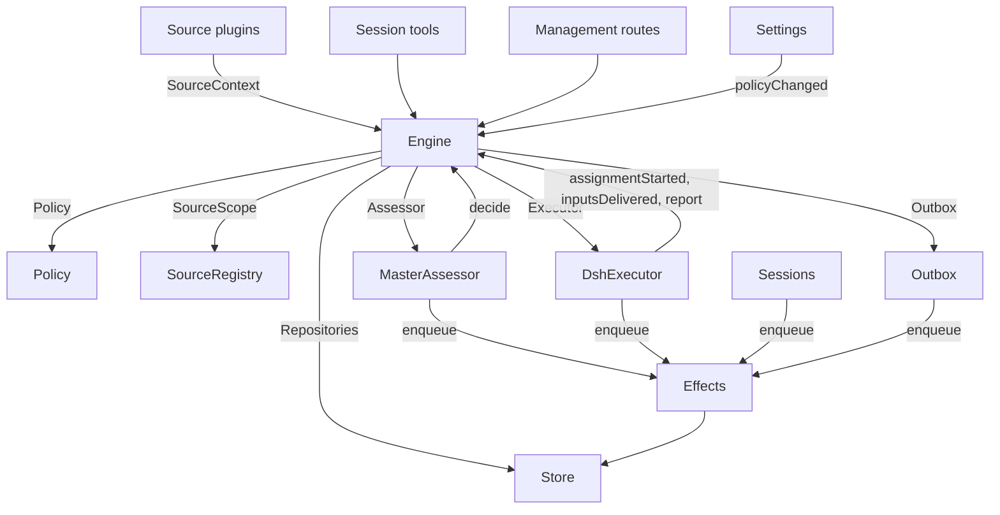

# 007 架构

> 本文件译自英文原文 [007-architecture.md](../007-architecture.md)。如有出入，以英文原文为准。

本文是实现层面的开发者指南。它把 [001 领域模型](001-domain.md) 到 [006 部署](006-deployment.md) 中的概念映射到类、接口和文件。请先看运行时与 Engine，之后把模块表和测试表当作代码索引。

## 核心类与胶水层

核心类通过小接口持有领域概念和外部边界。胶水层把工具参数、HTTP 请求、来源载荷和 DeepSeek Harness 事件转换成对这些类的调用，再把结果转换成卡片、视图和消息。

`Runtime`（`src/app/runtime.ts`）构建应用、提供依赖，并负责启动与关闭。`Engine` 构建自己的内部部件。执行器和评估器会回调 Engine，所以 Runtime 向它们提供 getter，而不要求按某种循环顺序构造。

### Runtime

`Runtime` 是组合根，不包含任何领域规则。它的构造函数锁定状态目录、打开 Store 并构建每个组件。如果构建失败，它会关闭 Store 并释放锁。

启动阶段注册管理路由并运行 Setup。setup 完成后，它安装会话与执行器钩子，确保主 Session 存在，启动策略同步，恢复被中断的派工，并启动轮次与副作用。`ready` 标记启动完成。

关闭阶段取消回合，等待轮次、副作用和代理结束，恢复进程环境，关闭 Store 并释放锁。来源插件通过窄接口 `SourceHost` 把 Runtime 作为 `orchestrator` 服务注入。

| 部分 | 模块 | 作用 |
| --- | --- | --- |
| Setup | `src/app/setup.ts` | 按工作者 shell 的运行方式探测各 CLI，以解析仓库和账户；写入并应用工作者的环境与命令 shim；保留 setup 问题。Settings 通过它检查变更后的账户，也通过它重启，而重启会再次运行 setup |
| Passes | `src/app/passes.ts` | 一次只跑一个轮次，每两秒一次，并在任何命令提出要求时运行：先执行到期的副作用，再运行 `Engine.evaluateDue`；来源的触发通过它到达 Engine |
| Outbox | `src/app/outbox.ts` | Engine 的 `Outbox` 端口，也是回执的唯一写入者：`send` 在一个事务中保存消息的回执并排队其 `reply` 副作用，该副作用的处理程序通过 `SourceRegistry.send` 发送它；来源关闭期间消息会等待，会话已消失或无人监听时消息被丢弃 |
| Notices | `src/app/notices.ts` | 把领域事件和工作者活动转换成主 Session 消息。`eventNotice` 处理领域通知；`reportRelay` 立即转发问题，把普通进展留在其工单上，并转发其他报告；`followupRelay` 列出拥有人工跟进的那些工单。回合进行期间到达的转发，会通过 DeepSeek Harness 收件箱在该回合的下一个步骤一并送达 |

### Engine

`Engine`（`src/core/engine.ts`）是触发、线程、决定、工单和派工的唯一写入者。它从 `src/core/ports.ts` 接收这些端口：`Repositories`、一个取当前策略的 getter、`SourceScope`、`Assessor`、`Executor` 和 `Outbox`。可选依赖是 `prepareTicket`、`now` 和 `emit`。

Engine 的所有方法都是同步的。每个命令在一个事务中修改它的聚合。`evaluateDue` 为它修改的每个评估或工单各用一个事务。端口在事务内把外部工作入队；适配器在提交后执行它。无效请求会抛出 `UserError`。

Engine 只暴露一个入口，并委派给五个内部部件。每个命令的事务由它自己持有。跨部件的命令，例如 `attach`、`evaluateDue` 和 `policyChanged`，会依次调用这些部件。

每个部件都继承 `EnginePart`（`src/core/part.ts`），后者提供选项和共享读取。部件之间的依赖只朝一个方向流动：

| 部件 | 职责 | 依赖 |
| --- | --- | --- |
| `Intake` | 来源的触发：连同其处置结果只存储一次，记录到它所在的线程及其关联上，分发给订阅的工单，并且，除非它是到达了某张工单的人的消息，否则在其主线程上排队等待评估 | Tickets |
| `Evals` | 线程的评估：批处理，准入判定的强度、参与者和依据及赋予它们的触发（`primary`），由候选送达时间得出的截止时间及其因暂停而顺延，过期评估的重新排队，候选、重放与交回，策略变更时的重新排队，以及每次评估最终形成的决定：接受、停止、忽略或不可用 | Tickets |
| `Tickets` | 工单生命周期：由一次接受创建，连同其授权、订阅和首个派工；它跟随的线程及其关闭（`followsDone`）；附加的线程和为上下文而跟随的线程；输入与备注；恢复以及恢复会拒绝的消息；重试、重启、停止和结束；它放弃的订阅；以及策略变更对它涉及的工单发出的通知 | Replies |
| `Assignments` | 执行器及其工作者报告的内容：派工已开始、输入已到达或未能到达、一次重启中断了它，以及工作者的报告及其向人提出的问题 | Tickets, Replies |
| `Replies` | 通过 `Outbox` 的渠道写入：确认、回答、结果和需要关注的消息，各自遵循允许它的规则 | 无 |

命令使用祈使式名称，例如 `stopTicket`；适配器报告的事实使用过去式名称，例如 `assignmentStarted`。查询 `candidate` 使用名词。

调用方只会拿到 Engine 中属于自己角色的 `Pick`：`EngineForSources`、`EngineForMainSession`、`EngineForPeople`、`EngineForSettings` 或 `EngineForExecutor`。

| 角色 | 方法 | 作用 |
| --- | --- | --- |
| 来源 | `receive(trigger)` | 只存储一次触发，并回答 `stored`、`duplicate`，或在没有来源接收它时回答 `filtered`；把它分发给订阅了其线程的工单，其中人的消息会立刻恢复已结束的工单，除非处理已暂停；并在它的主线程上排队等待评估，除非它是到达了某张工单的人的消息，此时它归那张工单所有 |
| 来源 | `bindThread(ticketId, thread, own)` | 让一张未结束的工单跟随来源的某个线程，例如某个 PR 的线程；若该工单打开了该线程，则 `own` 为真。已关闭的线程再次绑定时会重新打开。结束工单的是线程的关闭，而不是 `ready` 报告 |
| 来源 | `threadClosed(thread, outcome, at)` | 线程已关闭：每张跟随它的未结束工单记录这次关闭，并在它与其跟随的线程都已了结（`followsDone`）时结束：它打开的线程没有仍打开的，或者，当它没有打开任何线程时，它跟随的每个线程都已关闭。它按这些关闭中最晚的一次以 `merged` 或 `closed` 结束，除非关闭之后恢复的工作尚未报告 `ready`，或其执行器通过确认或回答，接手了一则它在其最新的非 `progress` 报告之后、或在其最后一个回合结束之后决定的人工跟进；此时 `dropped` 报告会按那次关闭的方式结束它 |
| 主 Session | `candidate(triggerId)` | 持有某个触发的评估，如评估器所见的样子 |
| 主 Session | `candidateDelivered(evalId)` | 该评估的候选已到达主 Session：它的截止时间从此刻起算 |
| 主 Session | `decide(triggerId, outcome)` | 记录一个评估决定，或为显式请求记录一个直接决定。接受会原子地创建工单、授权、派工、订阅和确认。从卡片上忽略的推断候选，会先记录 `ignoredFromCard`，再记录所给的原因。当 `followupOwners` 仍拥有人工跟进时，只允许停止 |
| 主 Session | `attach(ticketId, triggerId, note?)` | 把触发路由到它指向的工单，该工单的执行器随后把它作为跟进来决定，并结束持有该触发的评估，该评估的其他触发等待新的评估；已结束的工单会按它的授权立即恢复，除非处理已暂停。执行器仍在决定的跟进会被拒绝，被路由回交回它的那张工单的跟进也会被拒绝 |
| 主 Session | `requestStatus(ticketId)` | 向正在等待的执行器 Session 询问状态，并回答它是否询问了 |
| 主 Session | `note(ticketId, text)` | 把来自其他工作的事实作为文本输入交给工单的执行器，这不会授予任何权限 |
| 主 Session、执行器 | `reply(request)` | 为消息用途所指的渠道排队一条消息：`acknowledgement`、`answer`、`result` 或 `attention` |
| 人员 | `stopTicket(ticketId, reason?)` | 人的停止操作，会撤回授权 |
| 人员 | `retryTicket(ticketId)` | 结束某张工单停滞的派工，并开始新的派工；该工单在 `failed` 或 `blocked` 报告之后等待人工处理，或它的输入交付失败（`canRetry`） |
| 人员 | `reevaluate(triggerId)` | 把已存储的触发排队等待新的评估 |
| 人员 | `unsubscribe(thread)` | 放弃某个线程上的所有订阅，跟随该线程的工单不再跟随它；每张工单仍会决定它在那里收到的跟进 |
| 人员 | `dismiss(decisionId)` | 消除 `unavailable` 决定所显示的问题，该问题由该决定记录 |
| 执行器 | `assignmentStarted(ticketId, assignmentId)` | 派工开始运行；它等待的输入会被发出 |
| 执行器 | `inputsDelivered(ticketId, assignmentId, inputIds)` | 输入已到达该派工的执行器 Session，在其中每个输入等待某个步骤取走它 |
| 执行器 | `inputsRead(ticketId, inputIds)` | 执行器 Session 把承载这些输入的消息纳入其历史（一个 `user/message` 会话事件），其模型由此获得它们；此前已认领这些输入、但被取消或失败的步骤不算数。在报告或回合结束之后，每个输入即记为已读，重启后亦然，且其工单结束也不会让它失效；在读取被记录之前交付的输入，一旦其交付之后有报告或回合结束，也记为已读 |
| 执行器 | `turnEnded(ticketId, assignmentId)` | 执行器 Session 的一个回合结束，在报告之后亦然，此时后台没有为它运行的东西，或它正交接给人。步骤此前取走的内容即视为已读（`inputsRead`） |
| 执行器 | `deliveryFailed(ticketId, assignmentId, error)` | 交付输入失败；在交付成功、新的派工开始或工单结束之前，工单会一直显示该情况 |
| 执行器 | `report(ticketId, report)` | 记录一份报告及其向人提出的问题；`dropped` 结束工单，`ready` 完成一张不跟随任何线程的工单，并按所跟随线程结束的方式结束一张与其线程了结的工单 |
| 执行器 | `markUnrelated(ticketId, thread, reason)` | 只放弃该工单对某个它认为无关的附加线程的订阅，并带着原因交回该工单在那里决定的跟进 |
| 执行器 | `followForContext(ticketId, thread)` | 让未结束的工单为上下文订阅一个相关线程：其消息会到达工单，但不为其带来跟进强度，也不会恢复它 |
| 执行器 | `handback(ticketId, triggerId, reason)` | 记录该工单交回一个到达它的触发，并附上其候选携带的原因；如果没有其他工单决定它，且决定它的是本工单，则把它排队等待新的评估；方法回答是否已排队。每张工单对每个触发只交回一次，并保留其订阅 |
| 执行器 | `assignmentInterrupted(ticketId, assignmentId)` | 宿主停止时有派工正在运行：一个在工作中途被中断的派工，或一个在最新报告之后又收到输入的派工，会带一条恢复说明，以及已交付给它、其执行器 Session 尚未取走的输入，重新开始，如同一次重试；已经报告过的派工会保留其会话。DshExecutor 在启动时为每个这样的派工调用该方法（`resume`），最旧的工单优先，并重新排队仍在等待的启动 |
| 轮次 | `evaluateDue()` | 除非处理已暂停：为有排队触发在等待的线程启动评估，每个线程一次，把期间排队的触发作为一个批次；把已过截止时间的评估的触发再次排队两次，第三次则记录为 `unavailable`；并恢复暂停期间人的消息所到达的已结束工单，前提是它们的授权仍然有效。候选尚未到达主 Session 的评估不会过期。处理暂停期间没有评估过期，恢复后每个截止时间都按暂停时长顺延 |
| 设置 | `policyChanged(from, to, effects)` | 告诉每张受此变更影响的活跃工单会受到怎样的影响（`src/policy.ts` 中的 `policyEffects`：它被接受时依据的规则改变了或不再适用、其请求者可能无法再发起工作，或主动工作不再被接受），并按新版本重启进行中的评估 |

Engine 把批处理、授权、分发、恢复和需要关注的生命周期规则保持为私有。几个共享谓词让这些规则保持一致：

- `waitsForPerson`（`src/core/model.ts`）：最新派工报告了 `blocked` 或 `failed`，且此后没有人的消息到达。只要它为真，自动输入和失败的启动就保持等待。
- `followupOwners`：在自己的线程上收到人工跟进、且仍对其负责的工单。工单可以处于活跃状态，也可以在没有人工停止的情况下已结束并等待恢复。交回该消息即终止该归属。
- `settled`：某个决定解决了该请求；停止、不可用、已路由和被拒绝的停止决定不算。
- `ticketStage`（`src/core/stage.ts`）：实现 [003 执行](003-execution.md) 中的阶段表。

当工单结束时，未读的跟进会回到评估，除非另有工单仍拥有它们，或另有处置已解决它们。已确认、已回答和已交回的消息排除在外。对于没有确认处置的旧记录，由发件箱回执提供该事实。最终报告也覆盖派工开始时就已等待的消息，包括恢复它的那条消息。停止工单的那条消息不会被自动重新评估。

变更之后，Engine 会发出 `src/core/ports.ts` 中 `DomainEvents` 的一个事件：

`trigger.received`、`eval.started`、`decision.recorded`、`ticket.created`、`ticket.resumed`、`ticket.ended`、`assignment.started`、`assignment.ended`、`thread.subscribed`、`thread.unsubscribed`、`trigger.requeued` 或 `policy.changed`。

Runtime 把 `ticket.ended`、`trigger.requeued` 和 `thread.unsubscribed` 转换成通知。交付给工单的人类 `trigger.received` 会变成跟进转发。`pullEndNotices` 在工单以合并或关闭结束时发送一条聊天通知，使用稳定的 id。其他事件目前没有消费者。

### Model

`src/core/model.ts` 存放领域类型，`src/core/stage.ts` 存放工单阶段。决定以 `reason` 记录原因，它是一个 `Reason` 列表（`src/core/reasons.ts`）：每个 `Reason` 是一个 `code` 及其 `values`，对于批次中的某个触发，还有它的 `triggerId`。

核心自有的代码，例如 `timeout`、`policyChanged`、`routed` 和 `startedTicket`，都是 `REASONS`，带有代理通过 `reasonText` 读取的英文；准入判定或来源作用域会给出自己的代码，例如 `not_a_member`；`said` 则承载评估器或人写下的话。面板按 `reason.<code>` 为每个代码取词，被来源过滤的触发也以同样方式记录来源的代码。

工单对每个事实只保存一次。它在没有 `ended` 时处于未结束状态，`ended` 记录结束的时间、结束者、原因和结果；它最后说的话是它最新的派工报告（`latestReport`）；它的执行器 Session 以它命名（`src/executor/dsh.ts` 中的 `workerSessionId`）。

它的字段都是有类型的：`origin`，即赋予其评估批次强度、且被准入的那个触发，以及该批次本身（`triggerId`、`triggerIds`）；`execution`，即执行器选择的内容（`name`、`directory` 和 `assignment`）；`delivery`，最后一次失败的输入交付（`error`、`at`），直到一次交付成功、新的派工开始或工单结束为止；`follows`，来源让它跟随的线程，每个为 `{thread, own, closed?}`：工单打开了该线程时 `own` 为真，关闭后 `closed` 带有 `at` 和 `outcome`。只有 Tickets 写入 `follows`；GitHub 来源用 `pullsOf` 和 `pullOf` 读取其 PR（`src/sources/github-pull.ts`）。

承载触发的输入会记录它是否由人写下，`waitsForPerson` 会读取这一点。线程还在 `context` 中列出仅为上下文而跟随它的已订阅工单，并在 `expired` 中统计其排队触发的评估连续过期了多少次；一次评估记录它的 `primary` 触发及其候选 `delivered` 的时间。

触发的处置记录它到达的工单（通过分发或附加）、人的一次重新排队、每个交回它的工单及其原因，以及其执行器确认或回答了它的每张工单。

授权的 `basis`（`MandateBasis`）记录准入判定是如何放行其触发的。重新校验会读取接收方的 `source`、`scope` 和 `row`、所列的 `sender`、匹配的 `rules`，以及 `via`：

| `via` | 准入依据 |
| --- | --- |
| `addressed` | 允许的发送者点名了该代理 |
| `followup` | 消息到达了一个有工单的线程 |
| `admission` | 准入表的一个单元格；`observation` 标记推断出的候选 |
| `bot` | 所列的某个机器人产生了推断出的候选 |

触发和线程的 `meta` 属于来源。核心不解释它们。

### 策略

`src/policy.ts` 定义设置 schema、授权与评估规则。`settingsPolicy(settings, scope)` 每次调用都返回一个全新、无状态的 `Policy`：

- `version`、`paused` 和 `evalTimeoutMs` 描述它的当前状态。
- `gate(trigger, thread, tickets)` 返回准入强度和依据。
- `revalidate(mandate)` 检查已有授权是否仍然有效。
- `admitsInferred(rules)` 只在自动模式且匹配规则已启用时才允许主动接受。

`assessmentOutcome(assessment, settings, strength)` 把模型的评估转换成 Engine 的结果。它要求每个已启用的规则都有判断、方向已确定、存在匹配的规则，以及意图证据。在自动模式之外，推断出的接受会变成一条“本会接受”记录。

`policyEffects(tickets, old, now, scope)` 指出变更影响哪些未结束的工单以及如何影响。`Engine.policyChanged` 只通知那些工单。`policyVersion` 对规则、接受模式和来源的策略部分（包括机器人列表）做哈希。

### Store

`Store`（`src/app/store.ts`）持有一个 SQLite 数据库。Runtime 在打开它之前获取目录锁，防止第二个进程迁移或写入同一份状态。

它的接口按用途分组：

- **领域仓库：** `atomic`，以及 `triggers`、`threads`、`tickets` 和 `decisions`，各带 `get`、`save` 和列表查询。已建索引的工作集是 `threads.active()`、`tickets.open()`、`tickets.active()` 和 `read.subscribedThreads`。
- **读查询：** `read` 通过 `threadTriggers`、`triggerStats`、`search` 和 `droppedReplies` 之类的方法服务视图、工具和来源轮询。这些方法从不写入。
- **来源元数据：** `threads.describe` 和 `threads.patchMeta` 更新来源拥有的线程元数据。
- **设置：** `settings`、`saveSettings`、`blockRevision` 和 `settingsHistory`。设置和提示词使用带编号的 `Versions`（`src/app/versions.ts`）。
- **发件箱回执：** `replyStatus` 和 `receipts`，只由 Outbox 写入。回执操作有 `get`、`waiting`、`behind`、`add`、`settle` 和 `withdraw`。`behind` 检查同一工单、同一会话的更早消息是否仍在等待且失败少于三次。被撤回的消息以 `channelGone` 或 `channelIgnored` 结清。读查询通过 `failingReplies`、`droppedReplies` 和 `droppedSince` 暴露失败和丢弃的回复。
- **带类型的键值记录：** `get`、`set`、`delete` 和 `keys`，使用 `KV` 中的条目。

`afterCommit` 只在事务提交之后运行动作，绝不在回滚之后运行。Runtime 按记录存储时的形态读取记录；schema 11 迁移在启动时转换较旧的受支持记录。

### Effects

`Effects`（`src/app/effects.ts`）是持久化的副作用队列。命令在自己的事务内调用 `enqueue(kind, key, payload)`；执行只在提交之后开始。

每个 kind/key 对只有一行。对同一个仍在等待的 key 重复入队会替换其载荷并让它立即到期，而不改变队列顺序。`handle(kind, run, options)` 为每种类型注册一个处理程序。它按从旧到新的顺序处理到期的行，直到并发上限。

失败会以指数退避重试。抛出 `Later` 会推迟工作而不计一次失败，例如没有空闲的工作者槽位时。`start` 在 setup 之后开始处理，`drain` 在关闭时停止处理并保留待处理的行，`pending`/`idle` 暴露队列状态。

| 类型 | 处理程序 | 作用 | 立即 | 重试 |
| --- | --- | --- | --- | --- |
| `assessment` | MasterAssessor | 把评估的候选卡片引入主 Session 的回合，然后告诉 Engine 它已送达，这会启动该评估的截止时间 | 4，暂停时为 0 | 2 秒起，逐次翻倍至 60 秒 |
| `launch` | DshExecutor | 启动等待中的派工：prepare 命令、执行器 Session、派工消息 | 空闲的工作者槽位数，暂停时为 0 | 模型提供方或网络的暂时性失败在 5 秒后重跑，逐次翻倍至 300 秒，共三次；其他任何失败，以及 prepare 命令失败，都会让它的工单失败。因暂停或工作者槽位已满而被搁置的，5 秒后重试 |
| `delivery` | DshExecutor | 按顺序把工单等待的输入交给它正在运行的派工 | 4，暂停时为 0 | 2 秒起，逐次翻倍至 60 秒；等待工作者槽位的在 2 秒后重试 |
| `relay` | Sessions | 把工作者的报告或问题，或人的跟进，引入主 Session 的回合 | 1，按队列顺序 | 2 秒起，逐次翻倍至 60 秒 |
| `notice` | Sessions | 把通知注入主 Session 而不唤醒它 | 1，按队列顺序 | 2 秒起，逐次翻倍至 60 秒 |
| `reply` | Outbox | 通过来源为某个渠道发送消息，排在其工单发往该会话、且未失败三次的更早消息之后；撤回该消息即取消它 | 1，暂停时为 0 | 5 秒起，逐次翻倍至 300 秒；来源关闭的，或排在更早消息之后的，5 秒后重试 |

每种类型都以自己的名字拥有一条健康条目。当它的某个副作用连续失败三次时，它会报告错误，`delivery` 除外——它的失败改为显示在其工单上。转发保持顺序，通知亦然；失败的一个会挡住同类型中较晚的那些。

### 来源

来源通过 `SourceKind` 扩展宿主，该协议定义在 `src/sources/kind.ts`。一个 kind 声明自己的身份、标题、描述、配置 `schema` 和 `fields`、派生出的 `facts`，以及 `health` 条目。可选行为包括 `scope`、`channel`（`allowed`、`send`、`link`）、`threadContext`、`find`、`policy`、`environment` 和 `refreshLabels`。

`SourceRegistry`（`registry.ts`）持有已注册的 kind 和已存储的实例，并实现 Engine 的 `SourceScope`。注册会在 `HealthBoard` 上认领健康条目；重复认领和保留的 `sync:` 名称会被拒绝。`SourceContext` 只通过其注册所认领的条目写入，因此注销之后的报告什么也不做。

注册表的配置方法包括 `kind`、`instances`、`instance`、`validate`、`validatePolicy`、`policyPart`、`channelAllowed`、`declarations`、`environments`、`find` 和 `scope`。`find` 询问每个支持搜索的 kind。

通用代码通过注册表访问来源行为。`send(message, commands)` 调用该 kind 的渠道，并返回 `sent`、`gone`，或在 kind 未安装时返回 `waiting`。`link` 解析它的渠道链接。`threadContext` 把 kind 的读取器与其配置配对，kind 没有读取器时返回空。无效的已存储配置会禁用该实例。

插件收到 `SourceHost`：注册表和 `context(kind)`。kind 自身使用更窄的 `SourceContext`，由 `src/app/source-context.ts` 中的 `sourceContextOf` 构建。

该上下文提供部署与命令、setup 就绪状态（`ready`、`configured`、`problem`）、配置、`receive`、`atomic` 和带类型的 `state`。它还暴露线程读取与元数据写入、工单读取与绑定/关闭命令、触发读取、通过 Outbox 的 `notify`，以及为已声明的健康条目提供的 `report`。

### DshExecutor

`DshExecutor`（`src/executor/dsh.ts`）为每张工单提供一个会话和一个目录。`start` 和 `deliver` 会入队 `launch` 和 `delivery` 副作用。`stop` 通过 `Store.afterCommit` 取消回合，因此被回滚的结束不会停止工作者。

`prepare(ticket, outcome)` 提供 Engine 的 `prepareTicket` 钩子：短名称、目录和 `ticketExecution` 派工文本。`workerSessionId(ticket.id)` 派生出会话 id。

`WorkerSlots` 在启动之前，或在一次会唤醒空闲工作者的交付之前，预留容量。人的消息可以使用 `maxWorkers` 之外的一个槽位，唤醒优先于启动。`activeCount` 为面板提供负载。

模型提供方和网络的暂时性失败会获得三次重试。启动使用副作用退避；失败的回合会在 15、30 和 60 秒后收到续接消息。`inputMessage` 根据当前工单状态渲染每个输入，`mandateInstructions` 为推断出的工作添加匹配规则的限制。

`install` 订阅会话事件；`dispose` 取消订阅。回合结束通常报告等待，就绪之后或需要人介入时除外。错误报告失败。启动时，`resume` 通过 `assignmentInterrupted` 报告被中断的派工，并重新排队不等待人工的待启动项，最旧的工单优先。

### MasterAssessor

`MasterAssessor`（`src/app/assessment.ts`）让主 Session 评估主动候选。`request` 入队一个 `assessment` 副作用；`release` 在其评估结束时丢弃缓存状态。

它的 `context`、`read` 和 `decide` 方法服务 `orchestrator_eval`、`orchestrator_eval_read` 和 `orchestrator_eval_decide`。它们通过 `SourceRegistry.threadContext` 提供有界的线程上下文、仓库上下文，以及决定提交。没有上下文读取器的 kind 只提供触发和批次。

`assessmentOutcome` 转换模型对 `Engine.decide` 的回答。Evals 会再次对照当前策略检查推断出的接受。

### 设置

`Settings`（`src/app/settings.ts`）读写带修订号的设置块。`current` 和 `view` 读取它们；`save(block, value, revision, origin)` 校验一次保存；`pause(paused, origin)` 修改单独的 `paused` 设置。

每次保存都声明其来源：`panel`、`tool` 或 `sync`。只有 `panel` 能修改执行环境或 `SETUP_FIELDS`（`src/deployment.ts`）中列出的字段。

策略版本变更会计算 `policyEffects`、记录通知了哪些工单，并调用 `Engine.policyChanged`。`syncable` 和 `sync(id)` 刷新某个来源的策略部分。`refreshLabels(id)` 刷新显示名称。

### 提示词

`Prompts`（`src/app/prompts.ts`）以 `Versions` 存储配置。`current`、`version` 和 `history` 读取它们；`validate`、`preview` 和 `save(value, baseRevision, source)` 校验并保存它们。`compose` 和 `skills` 构建会话文本。

`builtInParts` 列出覆盖键、角色、默认文本和必需的模板占位符。每个覆盖项存储团队的 `text` 和一个 `base`：其原始默认值的 `builtInBase` 键。保存会在 `KV.prompts.builtIn` 下保留该默认值。`defaultChanged` 随后报告变更的默认值、可用时它们的旧文本，以及被移除的部分。

校验会从已保存的覆盖项继承省略的 base，丢弃已保存在数据中但被移除的部分，并拒绝空白文本或其他未知键。这使保存工具能把它读到的配置原样往返。`environmentSection` 和 `policySection` 只用自有键替换一次模板值。没有覆盖项的配置使用默认值。

### 会话

`Sessions`（`src/app/sessions.ts`）为两种角色管理 DeepSeek Harness 会话。`ensure` 用其角色的模型创建会话。`install` 跟随代理事件，并为受管会话注册提示词、技能和工具。

`prompt` 对每个请求 id 只交付一次。`relay` 和 `notify` 入队由 `relay` 和 `notice` 副作用处理的主 Session 消息。`src/app/notices.ts` 定义它们的内容；`delivery` 检查消息是否已到达。

每个模型请求都把会话绑定到当前的提示词修订。它用过的修订被持久保存：`promptVersion` 标识当前活动的那一版，`mayRead` 限制工作者能查看哪些版本。注册按代理记录在一个映射中。

`status` 和 `promptVersion` 服务提示词页面。保存经由 `Prompts.save` 并通知主 Session。`modelRetry` 暴露模型预算的重试状态。

### 胶水层

| 胶水 | 转换内容 |
| --- | --- |
| `src/app/runtime.ts` | 组合根：用各部分使用的接口构建它们，注册路由和来源宿主，并启动和停止 dsh-superagent |
| `src/app/notices.ts` | 把领域事件和工作者的报告转换成给主 Session 的通知和转发 |
| `src/app/tools/main.ts`、`src/app/tools/executor.ts` | 把主 Session 和执行器 Session 的工具参数转换成对核心类的调用，并把结果转换成卡片 |
| `src/app/http.ts`、`src/app/views/`、`src/app/api.ts` | 把 HTTP 请求转换成调用，把 Store 读取转换成面板的视图；`api.ts` 为面板标注每条路由的类型 |
| `src/app/resources.ts`、`src/app/links.ts`、`src/app/cards.ts` | 把资源名转换成读取、把来源消息转换成链接、把记录转换成给模型的紧凑卡片 |
| `src/sources/github*.ts`、`src/sources/feishu*.ts`、`src/sources/poll.ts` | 把 GitHub 和飞书载荷转换成触发和线程事实，把消息转换成 CLI 调用 |
| `src/deployment.ts`、`src/setup.ts`、`src/infra/` | setup 探测与问题、CLI 传输、代理的进程环境 |

## 依赖规则

- **显式而窄的依赖。** 每个类接收一个接口，接口指明它用到什么，多数是其他类的 `Pick` 类型：核心类的 `ExecutorHost`、`AssessorHost`、`SessionsHost`、`SettingsHost`、`SetupHost`、`PassesHost` 和 `OutboxHost`，胶水层的 `HttpHost`、`MainToolsHost`、`ExecutorToolsHost`、`ResourceHost`、`LinkHost` 和 `SourceContextDeps`，而 Engine 是调用它的那个角色的 `Pick`。Runtime 只在这种接口之后传递自身。来源插件注入 `orchestrator` 服务，其类型把它命名为 `SourceHost`：注册表和 `context(kind)`；其 kind 的代码只能看到自己的 `SourceContext`。
- **谁能导入谁。** `src/core` 除 Node 的哈希外不导入自身之外的任何东西，也不做 I/O。`src/sources` 不从 `src/app` 导入任何东西。面板只从宿主侧导入类型，以及 `src/admission.ts`、`src/limits.ts`、`src/setup.ts`、`src/navigation.ts`、`src/sources/host.ts`、`src/core/errors.ts`、`src/core/reasons.ts` 的普通值，还有 `src/app/api.ts` 中的过滤器列表。
- **每种状态只有一个写入者。** 每一类状态都有一个写入者，其他部分读取它或向该写入者询问。

  | 状态 | 写入者 |
  | --- | --- |
  | 触发、线程、决定、工单、派工 | Engine |
  | 来源的读取位置，以及它在自己线程上保存的 meta（`label`、`url`、`facts` 及其自有键） | 该来源，经由 `SourceContext` |
  | 设置及其历史 | Settings |
  | 提示词版本 | Prompts |
  | 副作用行 | Effects |
  | 发件箱回执 | Outbox：Engine 的消息和来源的 `notify` 都经它的 `send` 发出，其 `reply` 副作用标记它们 |
  | 健康条目 | 在 `HealthBoard`（`src/infra/health.ts`）上认领它的部分，后者拒绝第二次认领：`runtime` 是 Runtime，Passes 通过它报告；`evals` 是每个轮次之后的 Runtime；`models` 是 Sessions；每种副作用类型是 Effects；`worker` 是 DshExecutor；某个来源 kind 的条目是该 kind 的来源对应的 SourceRegistry；`sync:<id>` 是 Settings |

  来源只通过 `SourceContext.tickets.bindThread` 和 `threadClosed` 修改工单，而它们会调用 Engine。
- **请求与事实。** 请求某事的方法用祈使动词及其宾语命名，例如 `stopTicket` 或 `bindThread`，而且可以被拒绝；记录适配器做了什么的方法用过去式命名，例如 `assignmentStarted` 或 `deliveryFailed`。每个宿主以它需要的角色类型接收 Engine。
- **有类型的字段，来源数据放在来源之下。** 代码读取工单和授权的有类型字段。来源不在工单上保存任何东西：工单跟随来源的哪些线程，是工单的 `follows`；它关于某个触发或线程保存的内容，在它们的 `meta` 中。
- **固定的拒绝。** 人或代理引发的拒绝是来自 `src/core/errors.ts` 中 `USER_ERRORS` 的 `UserError(code, values)`。管理 API 对 `missing` 代码回答 404，对其他代码回答 400，面板用自己的语言为每个代码取词。setup 问题是 `SetupError` 代码（`src/setup.ts`），固定的健康文本是 `HealthCode`（`src/sources/host.ts`），取词方式相同。

### 与特定来源相关的依赖

有些通用模块仍然直接引用 GitHub 或飞书：

- Outbox 应用飞书聊天的字数限制。
- `src/app/links.ts` 解析飞书消息链接和 `repliedTo`。它和 Runtime 用 `feishuSettings` 读取设置。
- `src/app/resources.ts` 读取 `feishu/` 和 `github/` 的原始记录；`src/app/cards.ts` 为工单卡片使用 `pullOf`。
- Runtime 为已合并或已关闭的工单发送 `pullEndNotices`。
- 执行器工具用 `readPull` 和 `claimPull` 绑定上报的 PR，使用 Runtime 暴露的 GitHub 上下文。
- MasterAssessor 用 `readRepositoryPath` 读取仓库文件。
- Sessions 和 Prompts 只为 GitHub 和飞书注册内置技能。迁移会转换它们的 schema 10 记录。
- Setup 只探测 GitHub 和飞书的账户字段（`SETUP_FIELDS`）。只有这些来源会通过 `SourceContext.problem` 收到账户 setup 问题。

## 模块

| 路径 | 职责 |
| --- | --- |
| `src/index.ts` | 主插件入口：读取机器设置，启动 Runtime，并把来源账户保存时所用的重启交给它 |
| `src/deployment.ts` | 插件的 `Config` 和 `Machine`；`resolveDeployment` 和 `resolveFeishuBot` 从来源设置中读取仓库和账户，每次 CLI 都按执行器 shell 的运行方式运行；`SETUP_FIELDS` 列出 setup 读取的来源字段。代码不指名任何个人、账户或组织 |
| `src/setup.ts` | setup 问题：`SetupError`，带有代码、修复它的位置，以及日志、主 Session 和面板共用的英文文本 |
| `src/policy.ts` | 策略：按块划分的设置 schema、策略版本、准入判定和授权重新校验 |
| `src/admission.ts` | 准入表的值、每个单元格的选项和默认值，与面板共用 |
| `src/limits.ts` | 人设定的值的限制，设置 schema 会校验它们，面板的字段会提供它们 |
| `src/kv.ts` | `KV`：`kv` 记录的每个族，及其键、值的类型和所有者，以及 Store 和 `SourceContext.state` 接收的 `Key` 和 `Family` 类型 |
| `src/navigation.ts` | 宿主的目录列出会话后，从面板打开一个 DeepSeek Harness 会话 |
| `src/core/model.ts` | 领域类型，其中包括带类型的工单和 `MandateBasis`，以及 `threadKey`、`ticketOutcome`、`reached`、`followupOwners`、`settled`、`waitsForPerson`、`liveTicket`、`runningAssignment`、`latestAssignment` 和 `latestReport` |
| `src/core/ports.ts` | 端口：`Repositories`、`Policy`、`SourceScope`、`Assessor`、`Executor`、`Outbox`，以及领域事件 |
| `src/core/engine.ts` | Engine，核心的入口点，以及角色接口 `EngineForSources`、`EngineForMainSession`、`EngineForPeople`、`EngineForSettings` 和 `EngineForExecutor` |
| `src/core/part.ts` | `EnginePart`，Engine 各部件的基类，以及 `EngineOptions` |
| `src/core/intake.ts` | `Intake`：从来源到其工单的触发，以及（除非人的消息已到达某张工单）到评估的触发 |
| `src/core/evals.ts` | `Evals`：线程的评估及其决定 |
| `src/core/tickets.ts` | `Tickets`：工单生命周期、工单跟随的线程、订阅和输入 |
| `src/core/assignments.ts` | `Assignments`：执行器的事实及其工作者的报告 |
| `src/core/replies.ts` | `Replies`：Engine 的渠道写入 |
| `src/core/stage.ts` | `ticketStage` 和 `canRetry`：[003 执行](003-execution.md) 中的工单阶段 |
| `src/core/errors.ts` | `UserError` 和 `USER_ERRORS` |
| `src/core/reasons.ts` | `Reason`、`REASONS` 和 `reasonText`：核心为何记录某个决定或把某个触发搁置，按代码给出 |
| `src/core/ids.ts` | `key`：由输入派生出的 id，输入相同则 id 相同 |
| `src/core/memory.ts` | `MemoryRepositories`：Store 仓库的内存版本，保持 Store 的顺序及其嵌套回滚，用于领域测试 |
| `src/core/index.ts` | 核心的导出 |
| `src/app/runtime.ts` | Runtime，组合根，含其启动与停止 |
| `src/app/setup.ts` | Setup，以及 `setupChanged`，即一次保存是否改变 setup 读取的字段 |
| `src/app/passes.ts` | Passes，轮次调度器 |
| `src/app/outbox.ts` | Outbox：Engine 的 `Outbox` 端口、回执，以及发送它们的 `reply` 副作用 |
| `src/app/notices.ts` | 主 Session 的通知和转发：`eventNotice`、`reportRelay`、`resultRelay` 和 `followupRelay` |
| `src/app/store.ts` | Store，以及 `Receipt`，发件箱的一条消息 |
| `src/app/store-read.ts` | `storeReads`：供视图、工具和来源轮询使用的 Store 读查询，这些查询从不写入 |
| `src/app/migration.ts` | schema 11 迁移：从 schema 10 一步完成，按当前形态写入每条已存储记录 |
| `src/app/effects.ts` | Effects |
| `src/app/versions.ts` | `Versions`：以带编号的快照保存记录，并用指针指向当前快照，用于设置和提示词 |
| `src/app/cache.ts` | `TextCache`：在内存中按容量保存文本，最久未使用的先被丢弃 |
| `src/app/settings.ts` | Settings |
| `src/app/settings-history.ts` | `policyHistory`：每个已保存的设置修订，以及它相对上一版改变了什么 |
| `src/app/prompts.ts` | Prompts、`builtInParts`（团队可以覆盖的内置部分）和 `promptParts`（角色提示词各分节的顺序） |
| `src/app/context.ts` | 内置提示词文本，从 `prompts/` 读取，以及会话读取的会话记录条目 |
| `src/app/skill-files.ts` | 打包的文本：`promptFile`（把文件中一句一行的内容合并成段落）和打包的技能 |
| `src/app/sessions.ts` | Sessions |
| `src/app/delivery.ts` | `AgentDelivery`：按请求 id 向 DeepSeek Harness 代理交付消息，每次只交付一次，恢复会话后亦然 |
| `src/app/retry-health.ts` | `RetryHealth`：哪些会话在等待模型预算重试，供 `models` 健康条目使用 |
| `src/app/role-models.ts` | 解析评估和执行器的模型，并用其角色的模型为新会话做初始设置 |
| `src/app/assessment.ts` | MasterAssessor、评估 schema，以及 `orchestrator_eval` 回答所用的时间窗口 |
| `src/app/execution-environment.ts` | 执行环境：其变量、工单的值、目录根，以及 `src/app/prompts.ts` 填入其模板的提示词分节各行 |
| `src/app/source-context.ts` | `sourceContextOf`：每个来源 kind 的 `SourceContext` |
| `src/app/links.ts` | `sourceLink`（触发消息的页面）和 `candidateCard` |
| `src/app/cards.ts` | 给模型的触发、工单、线程和决定的紧凑卡片、工单卡片状态的封闭集合 `TICKET_STATES`，以及 `textPage` |
| `src/app/resources.ts` | `RESOURCES` 和 `readResource`：`orchestrator_read` 为每个角色读取的内容 |
| `src/app/tools/tool.ts` | `Tool` 类型、`readTool`、两种角色各自的 `orchestrator_read`，以及 `AcknowledgementSchema` |
| `src/app/tools/main.ts` | 主 Session 的工具 |
| `src/app/tools/executor.ts` | 执行器 Session 的工具 |
| `src/app/http.ts` | `/orchestrator/api` 路由：同源检查、请求限制，以及每种失败对应一个状态码 |
| `src/app/api.ts` | `Api`，每条路由及其参数、查询、请求体和响应，以及各列表的过滤器；它只导入类型，因此面板把它打包进插件包 |
| `src/app/views/text.ts` | 视图文本的两种形式：`preview`，单行纯文本；`markdown`，不含 HTML；以及 `plain` 和 `readable` |
| `src/app/views/records.ts` | 各视图共用的行：触发、工单、线程、决定和渠道链接，以及 `ownersOf`，即一次请求读到的跟进所有者 |
| `src/app/views/tickets.ts` | 按阶段划分的工单列表、工单页面、授权依据事实和执行器负载 |
| `src/app/views/threads.ts` | 线程列表、线程时间线、搜索和决定列表 |
| `src/app/views/sources.ts` | 来源状态：每个来源实例的状态、它最后一天的计数，以及它在当天过滤和丢弃了什么 |
| `src/app/views/settings.ts` | 设置页面的视图：每个块及其修订号、每个来源的设置及其 kind 的表单，以及执行环境 |
| `src/app/views/overview.ts` | 总览：需要人的工单、问题、最后一天的流量和执行器负载 |
| `src/executor/dsh.ts` | DshExecutor、`WorkerSlots`、`ticketExecution`、`inputMessage` 和 `mandateInstructions` |
| `src/executor/background.ts` | 工作者在 DeepSeek Harness 中的后台工作，其会话拥有的 shell 作业（`ctx.jobs`）及其子代理（`ctx.subagents`）：`runningJobs`、`untilQuiet`、`killJobs`、`collectJobs`、`stopSubagents`、`stopBackground`、`until`，以及 `cancelled`，即因停止其子代理而被取消回合的工作者 |
| `src/infra/commands.ts` | `Commands`，CLI 传输：`run`；`api` 和 `pages`，限定在已配置的仓库内并经过校验；以机器人身份运行的 `lark`；`git`。`CliError` 携带命令输出报告的代码，例如 GitHub 的 HTTP 状态；不打印任何内容的命令会以其结束方式失败，绝不暴露它的参数；`validItems` 跳过并统计列表中格式错误的条目 |
| `src/infra/environment.ts` | 代理的进程环境：命令 shim、git 配置和凭据助手、`runAsWorker`，以及对环境和工单目录的检查 |
| `src/infra/paths.ts` | 插件包的根目录，即打包文件所在之处 |
| `src/infra/text.ts` | 字数统计和聊天消息限制、`fill` 和 `sameName` |
| `src/infra/health.ts` | `HealthBoard`，每个部分的健康条目，各由其唯一写入者认领 |
| `src/sources/kind.ts` | `SourceKind` 协议 |
| `src/sources/registry.ts` | `SourceRegistry` |
| `src/sources/host.ts` | `SourceHost`、`SourceContext`、`Health`、`health` 和固定的健康文本 |
| `src/sources/poll.ts` | GitHub 与飞书轮询共用的部分：`POLL_HORIZON_MS`、`polled`、`cursorAt`，以及 `pollThreads`，它把失败以 `pollError` 留在其线程上 |
| `src/sources/github.ts` | GitHub kind 和插件入口，导出为 `./github-watch`：一轮通知轮询、未结束工单的 PR 及其 CI，以及已订阅的线程 |
| `src/sources/github-trigger.ts` | GitHub 的评论、审查、Issue 正文和 CI 变更作为触发，以及 GitHub 地址 |
| `src/sources/github-pull.ts` | PR 规则：工单跟随哪些 PR（`claimPull`、`observePull`）、它向 Engine 报告的关闭，以及 `pullEndNotices`，即以合并或关闭结束的工单的聊天通知 |
| `src/sources/github-channel.ts` | GitHub 渠道：评论和审查线程回复，`sent` 或 `gone` |
| `src/sources/github-read.ts` | CI 快照、仓库读取、`github/` 资源，以及 `githubThreadContext`：按页读取 Issue 或 PR 的对话 |
| `src/sources/feishu.ts` | 飞书 kind 和插件入口，导出为 `./feishu-watch` |
| `src/sources/feishu-trigger.ts` | 飞书消息作为触发，实时事件、历史分页和话题分页用同一套规则 |
| `src/sources/feishu-loops.ts` | 飞书的各个循环：事件消费者、历史恢复、聊天名称，以及已订阅话题的轮询 |
| `src/sources/feishu-channel.ts` | 飞书渠道：话题回复，`sent` 或 `gone` |
| `src/sources/feishu-read.ts` | 触发消息及其根、父级和话题的 `feishu/` 读取，以及 `feishuThreadContext`，它把这些连同图片一起交给评估 |
| `src/sources/admission-context.ts` | 评估起始的有界窗口：触发所在线程的最初几页（通过其 kind 读取），以及触发周围的消息 |
| `src/sources/feishu-image.ts` | 把飞书消息的图片读取为附件，供进行评估的会话使用 |
| `src/client/index.tsx` | 客户端插件入口：侧边栏条目、主面板，以及 DeepSeek Harness 插件管理器中的页面 |
| `src/client/app.tsx` | 面板：页头、搜索、术语表、标签页，以及当前路由的页面 |
| `src/client/provider.tsx` | 每个页面从宿主读取的内容：文案、调用、导航、通知、状态轮询，以及 `restart`，它在 dsh-superagent 重启期间快速读取状态 |
| `src/client/api.ts` | 管理 API 的调用和轮询，由 `src/app/api.ts` 定型，以及评估状态的决定过滤器 |
| `src/client/route.ts` | 标签页、设置分组、`parseRoute` 读取的带类型路由，以及最后打开的设置分组的路由记忆 |
| `src/client/overview.tsx` | 总览 |
| `src/client/source.tsx`、`trigger.tsx`、`eval.tsx`、`execution.tsx` | 每个阶段一个文件：其状态，以及它有的设置 |
| `src/client/thread.tsx`、`ticket.tsx` | 记录页面：带时间线的线程，以及带授权、输入和派工的工单 |
| `src/client/settings.tsx` | 设置标签页：分组导航和屏幕上的分组 |
| `src/client/settings-kit.tsx` | 设置块的构件：各阶段分组共用的设置、`useBlockDraft`、各个字段（其中包括来源 kind 的字段），以及保存历史 |
| `src/client/prompts.tsx` | 提示词设置：页面持有它读到的视图，编辑器持有草稿，编辑、完整提示词和历史标签页由它们渲染；内置部分的编辑器会显示变更过的默认值，并保留或丢弃覆盖项 |
| `src/client/prompt-config.ts` | 以纯函数形式提供的：按分节、按团队分节、技能名称、内置部分（`part/<key>`，带 `withOverride`）和提示词视图给出的部分标题所划分的提示词配置，以及完整提示词的行级 diff |
| `src/client/deployment.tsx` | 部署设置，也会在 DeepSeek Harness 的插件管理器中显示 |
| `src/client/draft.tsx` | 设置草稿：`draftReducer`、它们的状态及其与更新的已保存修订的合并、`saveBarText`（保存栏的那行文字），以及保存栏 |
| `src/client/controls.tsx` | DeepSeek Harness 控件的本地副本，遵循其标记结构、键盘行为和设计 token，因为插件包不导入 `@deepseek-ai/dsh-client-ui-primitives`；它们不读取任何上下文 |
| `src/client/widgets.tsx` | 各页面共用的小组件，它们读取面板的上下文：分节、页面标题、加载状态、时间、链接、需确认的操作、setup 检查和 Markdown |
| `src/client/rows.tsx` | 各页面共用的行：工单、线程和决定、线程的标签片，以及连续自动化消息的折叠 |
| `src/client/markdown.ts` | 报告和问题所用的 Markdown 子集，以及消息中的裸地址，作为块和内联部分 |
| `src/client/text.ts` | 按键取文案，以及领域值、原因、发送者和时间的措辞 |
| `src/client/marks.ts` | 视图所分类的各状态的标记：工单或线程的阶段、来源的状态和决定的结果，每个都是一个圆点、一个图标、一种色调和一个标签 |
| `src/client/locales.ts` | 两种语言的全部文案，以及 [001 领域模型](001-domain.md) 的术语表 |
| `src/client/client.css`、`css.d.ts` | 面板的样式表，以文本形式加载 |

`src/sources/github.ts` 和 `src/sources/feishu.ts` 也是两个来源插件的入口，由 `tsdown.config.ts` 构建，并在 `package.json` 中导出为 `./github-watch` 和 `./feishu-watch`。插件包的 `cordis.patch.yml` 插入这三个插件，其中飞书处于禁用状态。

## 测试

| 测试 | 覆盖内容 |
| --- | --- |
| `tests/core-engine.spec.ts` | 内存仓库上的领域规则：接收、评估、分发、恢复与停止、被中断的派工、暂停、策略变更、报告与结果、附加、回复、失败的交付和已消除的问题 |
| `tests/stage.spec.ts` | 工单阶段，逐行 |
| `tests/policy.spec.ts` | 来源作用域、准入判定、准入表、授权重新校验、策略版本、设置迁移和评估结果 |
| `tests/registry.spec.ts` | `SourceRegistry`：实例、校验、策略部分、渠道和线程上下文 |
| `tests/sources.spec.ts` | 在 `SourceContext` 上的飞书和 GitHub 来源：转换、轮询和读取位置、PR 规则、健康 |
| `tests/commands.spec.ts` | 以部署的账户身份发起的 CLI 调用、渠道的回答，以及限定在仓库内的 GitHub 调用 |
| `tests/feishu-read.spec.ts`、`tests/github-read.spec.ts` | 飞书和 GitHub 的读取 |
| `tests/admission-context.spec.ts`、`tests/feishu-image.spec.ts` | 评估的线程窗口，以及飞书图片读取 |
| `tests/assessment.spec.ts` | MasterAssessor 为每次评估保留什么，以及何时放手 |
| `tests/background.spec.ts` | 等待工作者的 shell 作业和子代理：一次唤醒它的结束，以及一个停止的宿主 |
| `tests/bundle-patch.spec.ts` | 插件包的补丁，按 DeepSeek Harness 的读取方式读取，以及它定义的执行器 Session 代理预设 |
| `tests/effects.spec.ts` | 副作用队列：合并、限制、退避重试、健康和关闭 |
| `tests/passes.spec.ts` | Passes：一次一个，轮次期间被请求的那些会在该轮次之后作为一个轮次运行，以及失败的轮次所报告的运行时健康 |
| `tests/outbox.spec.ts` | 运行中的 Runtime 上的 Outbox：处理暂停或其来源未安装时消息会等待 |
| `tests/cache.spec.ts` | `TextCache` |
| `tests/queue.spec.ts` | Runtime 的工作经由副作用队列，以及更早版本存储了什么 |
| `tests/followups.spec.ts` | 人在工单线程上的跟进：它发往主 Session 的通知、对它采取行动的工具、一次突发的开销；工作者的交回和上下文跟随，以及主 Session 的备注 |
| `tests/health.spec.ts` | 每个部分一个健康条目，各自由其下一次成功清除 |
| `tests/delivery.spec.ts` | `AgentDelivery` |
| `tests/retry-health.spec.ts`、`tests/role-models.spec.ts` | 模型预算重试，以及两种角色的模型 |
| `tests/runtime.spec.ts` | 在模拟的 DeepSeek Harness 宿主上的整个应用，经由工具和 HTTP |
| `tests/tools.spec.ts` | 会话的工具：`orchestrator_read` 为每个角色读取什么，以及其他主 Session 工具的形状和校验 |
| `tests/runtime-concurrency.spec.ts` | 相互重叠的工作：轮次期间的触发、在交付和启动期间发生变化的工单 |
| `tests/http.spec.ts` | 同源和回环检查、每种失败的状态码、请求体上限、路径参数和查询 |
| `tests/settings.spec.ts` | 与模型或账户检查竞争的设置保存、被保存抢先的策略同步，以及暂停、同步和阻塞的拒绝 |
| `tests/views.spec.ts` | 管理视图从 Store 派生出的内容，例如被丢弃的消息属于哪个线程 |
| `tests/timeline.spec.ts` | 线程的分页，以及触发按时间再按 id 的邻居，所有收到的触发时间都用同一种形式 |
| `tests/migration.spec.ts` | schema 11 迁移：每条已存储记录的当前形态，以及对更旧 schema 的拒绝 |
| `tests/store.spec.ts` | 仓库及其工作集（SQLite 与内存中一致）、kv 区域，`KV` 的每个键只在 `src/kv.ts` 和迁移中拼写，以及设置历史与查询 |
| `tests/prompts.spec.ts` | 提示词校验、组装和版本 |
| `tests/cards.spec.ts` | 内置文本必须陈述的规则，逐文件 |
| `tests/model-surface.spec.ts` | 模型读取的一切：工具、提示词、技能和输入，对照工具 schema、执行环境和术语表检查，并受每个角色的大小预算约束 |
| `tests/deployment.spec.ts`、`tests/environment.spec.ts`、`tests/index.spec.ts` | 插件配置与 setup、代理的进程环境、插件入口 |
| `tests/service-script.spec.ts` | `scripts/dsh-superagent` 面对伪造的 `ps`、`tmux` 和 `dsh` |
| `tests/client.spec.tsx`、`tests/navigation.spec.ts`、`tests/controls.spec.tsx` | 客户端插件的注册和轮询、会话导航和路由记忆、本地控件，以及面板的导入（没有循环） |
| `tests/panel-overview.spec.tsx`、`panel-source.spec.tsx`、`panel-trigger.spec.tsx`、`panel-eval.spec.tsx`、`panel-execution.spec.tsx` | 面板的每个页面，面对按路由应答的伪造管理 API |
| `tests/panel-settings.spec.tsx`、`panel-prompts.spec.tsx`、`panel-deployment.spec.tsx`、`panel-panel.spec.tsx` | 设置分组、草稿和历史、提示词、部署页面，以及面板的搜索、术语表和路由记忆 |
| `tests/draft.spec.ts`、`tests/prompt-config.spec.ts`、`tests/markdown.spec.ts`、`tests/marks.spec.ts` | 草稿状态、合并和保存栏的那行文字；按分节划分的提示词配置和行级 diff；Markdown 子集及其链接；视图所分类的每个状态的标记 |
| `tests/locales.spec.ts`、`tests/styles.spec.ts` | 两种语言的文案、样式表 |
| `tests/class-docs.spec.ts` | `src` 中的每个类前面都有 JSDoc 块 |
| `tests/docs.spec.ts` | 编号文档只链接到更早的文档，每个本地链接都能解析，没有文档带有合并冲突标记，并且本文档的表格列出了每个模块和每个测试 |

`tests/fixtures/` 存放多个测试共用的内容：`host.ts`，模拟的 DeepSeek Harness 宿主；`panel-server.ts` 和 `panel.tsx`，伪造的管理 API 和页面周围的面板；`deployment.ts`，解析后的部署；`git.ts`，测试启动的每个 git 的环境，其中不指名任何仓库；以及 `async.ts`。

## 持久化

一个 SQLite 文件，`<stateDir>/orchestrator.sqlite`，只有 Store 打开它。

| 表 | 内容 | 写入者 |
| --- | --- | --- |
| `trigger` | 每个触发，其时间 `at` 采用 `Date#toISOString` 给出的唯一形式，在 Engine 收到它时设定，因此时间可按文本比较 | Engine |
| `disposition` | 每个触发去了哪里：`filtered` 连同来源的原因代码、它的评估和决定、它通过分发或附加到达的工单、它是否被重新排队、交回它的工单及其原因，以及其执行器确认或回答了它的工单 | Engine |
| `trigger_thread` | 每个触发位于哪些线程上，连同其时间以及是否由人写下，因此读取线程的触发无需扫描每个触发，按时间再按 id 排序：线程时间线的一页从 `<at>|<id>` 游标继续，共享同一时间的触发不会被跳过 | Store，随每个触发 |
| `thread` | 线程：订阅、为上下文而跟随它的工单、排队的触发、进行中的评估、其过期次数和 `meta`；生成列 `active` 在有触发排队或评估运行时置位，`subscribed` 在有工单订阅它期间为它的来源 | Engine；来源写入 `meta` |
| `ticket` | 工单及其授权、来源、执行、派工、渠道、输入和它跟随的线程；生成列 `open` 在它尚未结束时置位，`active` 在输入尚未交付或最新派工处于待启动或运行中时置位 | Engine |
| `decision` | 决定，按线程 | Engine |
| `effect` | 副作用队列：按类型和键保存载荷、它的顺序、失败尝试及最后的错误，以及它何时到期 | Effects；schema 11 迁移会把更早版本为主 Session 保留的内容入队 |
| `outbox` | 每条发往某个渠道的消息的回执，按 id 保存，带有它所属的工单及其 `status`（`pending`、`sent` 或 `dropped`），保留它是为了让同一个 id 绝不会被排队两次；对于被丢弃的消息，还有何时与为何，作为生成列 `dropped` 的时间和一个原因代码。等待中的消息有一个 `reply` 副作用，由它持有其尝试 | Outbox |
| `kv` | 其他每条记录，按键 | 命名它的那个部分 |

生成列由其行的 JSON 计算得出，在其集合之外为空，每个生成列都在其集合上有索引，因此一次轮次只读取活跃的工作。早于某一列的数据库会在 Store 打开它时获得该列。

`KV`（`src/kv.ts`）定义每个键值记录的所有者、键和类型。所有读写者都使用这些条目；只有迁移代码会指名更旧的键。

| 记录 | 键或内容 |
| --- | --- |
| Schema | 当前 schema 版本 |
| 设置版本 | `settings-revision`、`settings-version:<n>`、`settings-block-revision:<block>`；快照包含来源、策略版本和受影响的工单 |
| 提示词版本 | `prompt-revision`、`prompt-version:<n>` |
| 主 Session | `master-id` |
| 会话提示词历史 | `session-prompts:<session id>` |
| 来源状态 | `github-cursor:<number>` 之类的读取位置、PR CI 指纹和已见到的飞书话题消息；键以 kind 或 `thread-` 加线程键开头 |
| 显示名称 | `source-labels:<source id>` |

消除操作存储在它的决定上。输入文本在读取时由工单渲染，因此两者都不需要单独的键值记录。

读缓存使用有界的内存 `TextCache` 实例，重启后即丢失。会话在翻页浏览来源原始记录或提示词预览时，重启后必须从偏移 0 重新读取。在接收之后解析的飞书链接以同样方式缓存；基于链接的搜索只有在当前进程生命周期内读取过该链接之后才能找到它们。

目前没有任何机制删除旧记录，因此以下内容会无界增长：`trigger`、`disposition` 和 `decision` 行；已结束的工单及其线程；发件箱的回执；以及 `kv` 中每个已保存的设置修订和提示词版本、每个会话曾在其下工作的提示词修订，以及来源按线程、按 Issue 或 PR 保存的记录。

`SCHEMA_VERSION` 只增不减。更新版本的数据库会拒绝启动；`src/app/migration.ts` 在启动时把预发布 schema 10 的数据库升级一次，并拒绝更旧的数据库。

## 面向模型的接口

### 主 Session 工具

主 Session 有 14 个应用工具：

| 用途 | 工具 |
| --- | --- |
| 读取与路由 | `orchestrator_read`、`orchestrator_route` |
| 管理工单 | `orchestrator_ticket_retry`、`orchestrator_ticket_request_status`、`orchestrator_ticket_note` |
| 重新评估 | `orchestrator_trigger_requeue` |
| 评估主动工作 | `orchestrator_eval`、`orchestrator_eval_read`、`orchestrator_eval_decide` |
| 沟通与取消订阅 | `orchestrator_reply`、`orchestrator_thread_unsubscribe` |
| 配置 | `orchestrator_settings_save`、`orchestrator_policy_sync`、`orchestrator_prompts_save` |

`orchestrator_route` 按顺序接受 1–20 个决定。每个接受、附加、停止或忽略都作为单独的 Engine 命令运行。它还允许直接从卡片上忽略推断出的候选。`orchestrator_ticket_note` 把事实作为上下文发送，而不是作为权限。

设置保存选择 `policy`、`eval`、`executor`、`pause` 或 `source`；最后一个还要指名其来源 id。带 `preview: true` 的提示词保存只组装文本而不保存。

主 Session 还拥有 DeepSeek Harness 的 `skill`、`bash`、`read`、`read_image`、`job_output`、`job_list` 和 `job_kill`。避免读取代码是一条提示词规则，而不是工具限制。

### 预设与等待上限

新的主 Session 使用 `dsh-superagent-router`（`ROUTER_PRESET`）。shell 命令和作业等待在 5 秒后返回。如果 Web UI 在首个回合之前选择了另一个预设，`Sessions` 会恢复这个预设，对工作者则恢复 `WORKER_PRESET`。

`src/app/sessions.ts` 中的 `noWait` 守卫会拒绝主 Session 中在命令位置调用 `sleep` 的 shell 命令、超过 30 秒的 shell `timeoutMs`，以及超过 5 秒的 `job_output` 等待。报告和作业结果会自动到达，因此等待只会推迟到来的候选。

已在使用 `standard` 的主 Session 还需要为前台命令和作业等待显式设置超时；否则该预设的默认值会分别让步骤停留 60 秒和 30 秒。宿主通过 `presetForSession` 确定当前预设，回退到会话投影或头部，无法读取该值时则假定为 `standard`。

### 执行器工具

每个执行器有六个应用工具：

| 工具 | 用途 |
| --- | --- |
| `orchestrator_read` | 读取它自己的工单可用的资源 |
| `orchestrator_ack` | 确认一个请求 |
| `orchestrator_report` | 报告进展或结果，按 PR 规则绑定 PR |
| `orchestrator_thread_unrelated` | 放弃一个无关的附加线程，交回它拥有的跟进，并告诉主 Session 原因 |
| `orchestrator_thread_follow` | 为上下文订阅一个相关线程，并告诉主 Session |
| `orchestrator_trigger_handback` | 交回一条消息一次，并附上其候选携带的原因 |

如果另一张工单仍拥有该消息，或本工单从未拥有过它，交回会返回 `queued: false`。例如，机器人消息独立地进入了评估。

工作者预设在 `cordis.patch.yml` 中定义，并通过 `WORKER_PRESET` 选择。`src/app/sessions.ts` 中的 `WORK_TOOLS` 保留可用的文件、搜索、shell、作业、web、技能、待办和子代理工具。工作者不会获得用于向人提问或展示、修改 profile、在工作者槽位之外安排工作、启动或向其他会话发消息，或编辑外部文档的工具。工单结束后，工具调用会被拒绝。

### 结果形状与评估上下文

路由结果使用 `{decision?, reason, ticket?}`。`orchestrator_route` 返回 `{results}`，保持条目顺序，并为每个条目加上 `trigger_id` 和 `kind`。无效或被拒绝的条目返回 `refused` 和一个原因，而不会中断批次。

设置和提示词保存返回已保存的配置。策略同步返回来源、允许列表大小，以及 `added` 和 `removed` 名称。

`orchestrator_eval` 返回的是上下文而非指令。评估指令位于 `runtime/admission`（`prompts/admission.md`），规则位于 `runtime/policy`。它的上下文包括：

- 触发文本，最多 4,000 个字符，连图片 id 和批次中的其他触发。
- 最多八个 `related_tickets`，未结束的在前，以及 `tickets_total`。
- 该评估的 `policy_version`。
- 一个线程窗口：前五条消息，以及触发两侧各五条。消息使用 `{id, from, at, text}`，通常限制为 400 个字符，两侧各两条消息则为 1,200 个字符。被截断的消息包含 `chars`；图片引用使用 `images`。
- 其他已加载的消息以 50 个字符的 `{id, from, preview}` 存根表示。`orchestrator_eval_read` 按 id 展开它们。

工单卡片使用 `src/app/cards.ts` 中封闭的 `TICKET_STATES` 集合：一个未结束的阶段，例如 `person/review` 或 `working/queued`，或一个已结束的结果。无论通过接受、评估还是 `orchestrator_ack` 提交，确认都限制在 100 词以内。

### 读取资源

`src/app/resources.ts` 中的 `RESOURCES` 定义资源，并生成工具的 `resource` 描述。

| 资源 | 内容 |
| --- | --- |
| `tickets`、`triggers`、`threads`、`decisions` | 分页列表，形如 `{items, next_offset}`；活动列表最新的在前 |
| `decision/<id>` | 单个决定 |
| `thread/<key>` | 标签、工单、最近的决定，以及一页触发 |
| `trigger/<id>` | 消息文本、被回复的触发和相邻消息，不含 CI 运行 |
| `ticket/<id>` | 相关 id、来源批次的触发、线程，以及派工和输入的第一页 |
| 工单子资源 | `/assignments`、`/inputs`、`/assignment`、`/result`、`/report/<assignment id>`、`/transcript`、`/message/<n>`、`/input/<id>` |
| `settings`、`settings/<block>` | 修订和摘要，或一个可直接保存的完整块 |
| `prompts`、`prompts/<revision>`、`prompts/current`、`prompts/defaults`、`prompt-preview/<id>` | 提示词配置和组装后的文本 |
| `models`、`models/<provider>` | 可用的模型 |
| `feishu/<trigger id>/…`、`github/…` | 来源原始记录，在来源技能中说明 |

仅为上下文而跟随的工单线程标记为 `context`，来源绑定的标记为 `bound`。派工页面最新的在前，并包含报告预览。用 `next_offset` 继续列表。`/input/<id>` 接受输入的名称或 id。`settings` 完整包含小型的块，并汇总策略和来源块。

来源资源包括消息邻域、`github/pulls/<n>/thread/<comment id>` 和 `github/commits/<sha>/checks`。

原始记录的消息以同一种紧凑形态读取，`{id, from, at, text, reply_to?, path?, line?, url?}`，而不是按 GitHub 或飞书记录它们的方式。

执行器 Session 只读取它自己的工单、它的线程、到达它的或它的请求所持有的触发、它曾在其下工作的提示词版本以及原始记录，其页面会略去它无法读取的内容的 id、决定和其他工单。

页面显示的每个 id 都通过这些资源之一读取，因此会话从一个对象走到下一个；没有任何读取会依据的哈希，例如评估的 id 或策略版本，不会出现在页面上。

文本页面默认 4,000 个 UTF-16 码元，最多 8,000 个；列表默认 20 项，最多 50 项。

更早版本的名称 `event/`、`task/` 和 `observation/` 仍然可以解析。

### 交付给会话的消息

以下消息会被引入主 Session 的回合：

| 消息 | 内容 |
| --- | --- |
| Candidate | 批次触发卡片、线程、`related_tickets`、`tickets_total`、`delivered_to`、由 Issue/PR 链接引用的工单、`handed_back` 原因，以及下一步动作 |
| `follow_up` | 一条消息在执行器眼中的样子、`replies_to`、接收它的工单，以及提醒：由执行器决定它，而主 Session 只能停止工作 |
| `worker_report` | 工单卡片、原始触发、状态和最多 600 个字符的摘要；被截断时有 `chars` 和读取指针 |
| `worker_attention` | 携带该问题的工单卡片 |

其他通知会在不唤醒主 Session 的情况下注入：`ticket_ended`、`settings_saved`、提示词保存、触发重新排队、被放弃的订阅和上下文跟随。设置通知会指名块、变更的路径和 `read: settings/<block>`。对于主 Session 自己执行的保存、重新排队、取消订阅或附加，它不会收到多余的通知。

工作者以内联方式收到派工和输入。第一条消息包含标题、最多 1,500 个字符的派工文本和来源触发卡片。输入携带最多 600 个字符的触发卡片和 `replies_to`，或纯文本输入。读取指针只出现在内容被截断时。

### 仅面板可做的操作

没有工具用于消除不可用的决定、重新运行 setup、刷新来源显示名称，或把执行器拥有的人工跟进送入评估。最后一个操作被 `orchestrator_trigger_requeue` 特意拒绝。其他面板操作都有等价的工具。

大多数内置指令位于 `prompts/*.md`，一句一行，由 `promptFile` 连接。来源技能位于 `skills/dsh-superagent-*/SKILL.md`。工具描述和固定通知（例如重启恢复说明）仍留在代码中。评估指令只位于 `prompts/admission.md`。

`tests/model-surface.spec.ts` 检查这些表面是否发生漂移。[004 提示词](004-prompts.md) 说明团队可编辑的部分。

## 配置重载

除 `stateDir` 外，每个插件配置键都是易变的。面板的部署设置和 DeepSeek Harness 的插件管理器通过 DeepSeek Harness 的配置表编辑它们；宿主写入 `cordis.patch.yml` 并就地更新这些值，而 dsh-superagent 在用到每个限制时才读取它，因此变更无需重启即可生效。

一次改变 setup 所读来源字段（例如账户的 CLI）的设置保存，以及 setup 等待期间的任何保存，都会重启 dsh-superagent。DeepSeek Harness 的设置服务在该重启期间不提供该条目，因此在自身重启之后，dsh-superagent 会让它再次读取该条目，打开的表单也会重新可编辑。

## 对照真实数据审查变更

把 `DSH_HOME` 指向一个临时目录，并在那里创建新的 profile。从备份复制数据库，禁用所有来源，暂停处理并移除主 Session id。为 GitHub 和飞书 CLI 提供只读的替身。

## 待解问题

- 信任：哪些触发字段被信任，例如来源的参与者身份和线程成员关系，哪些不被信任，例如正文和引用。
- 部署隔离：把代理的 profile 放在自己固定版本的 DeepSeek Harness 安装上，这样在别处升级 DeepSeek Harness 不会破坏它。
